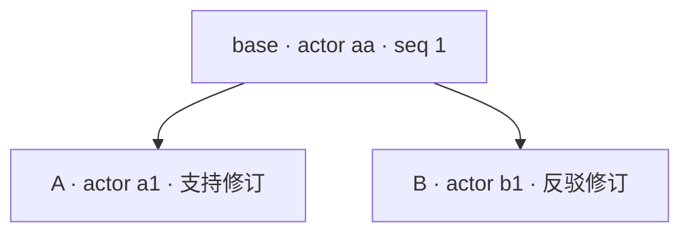

# 因果历史与并发知识修订：Automerge、快照与授权边界

状态：本轮实验已实现并直接运行 `scenario.js`；主线程独立smoke已成功，并保存了精选摘要[causal-history.json](evidence/10-semantic-boundaries/causal-history.json)（省略随机hash/time）。全仓`pnpm test`通过：89项通过、0失败/跳过；随后清理模拟日志、文案与重复投影的偶然断言，最终实验15/16定向运行2项通过、0失败。本轮汇总结论见[10-semantic-boundaries](conclusions/10-semantic-boundaries.md)，以同名Git标签复现。本文保留初始判断、被实现否定的假设及修正，不把合并收敛当作知识正确或动作安全。关联[案例1](cases/1-heterogeneous-engineering-workspace.md)的情境5（处理不完整信息）与情境7（协作与知识修正），也参考[知识闭环](conclusions/6-operations-truth-loop.md)中“文档修正不等于自动认证真理”的结论。

## 1. 问题

两个 Agent 基于同一份知识快照离线工作：

- Agent A 观察到“配置刷新后重启仍保留有效配置”，把知识记录改为支持重启；
- Agent B 观察到“重启会回退启动覆盖”，把同一条记录改为反对重启；
- 两者都认为自己的证据适用于同一 release 条件。

需要回答的不是“如何让两份 JSON 合并”，而是：

1. 合并后能否知道曾经有两个相反修订，而不是只剩一个赢家？
2. 默认读取看到的是什么？它是否可能是一条任何 Agent 都没有写过的记录？
3. 历史能否说明“谁在什么因果位置写了什么”？它能否说明“谁有权写”或“这条知识为真”？
4. 把 Automerge 文档投影成普通 JSON 再导入，哪些语义会丢失？
5. 合并已经收敛后，已经授权并执行的外部动作能否被撤回？

本文把“知识记录”当作一个有字段约束的普通对象，不预设 Locus 需要新的 Core 类型。实验只比较两种可执行方案：

- **原生 JS 快照**：最新 JSON + 版本哈希 + 可选字段时钟；合并是应用自定义策略。
- **Automerge 3.5.0**：成熟的 JSON CRDT 实现，保留 change DAG、逐属性冲突和二进制存储。

## 2. 历史与设计比较

### 2.1 Automerge 的基本机制

Automerge 的文档是一个可协作编辑的 JSON-like 结构，序列化形式包含完整变更历史。一个 **change** 是一组操作的提交，类似 Git commit：有 actor、依赖的前驱 change、可选时间与消息，change hash 是二进制 change 的 SHA-256；actor ID 是任意字节序列，操作 ID 是 `(actor, counter)`。每个文档有根 map，变更图可以有多个 head；两个文档只要有共同历史就可以合并，不需要中心服务器或全序广播。[二进制格式规范](https://automerge.org/automerge-binary-format-spec/)；[Automerge 概念](https://automerge.org/docs/reference/concepts/)。

并发写同一个 map 属性（或同一个 list 索引）时，Automerge 使用多值寄存器保留所有并发值；默认读取按操作 ID 选一个确定性的赢家，`getConflicts` 返回赢家与输家。默认读取的“最后写入”不是墙钟时间，而是操作 ID 的 counter，counter 相同再用 actor ID 打破平局；下一次赋值会把冲突视为已解决。文本/列表的并发插入也保留，counter 的并发增量按和合并。[冲突文档](https://automerge.org/docs/reference/documents/conflicts/)；[合并规则](https://automerge.org/docs/reference/under-the-hood/merge-rules/)。

其理论来源是 JSON CRDT：用多值寄存器处理叶子并发赋值，用 RGA 类结构处理列表，目标是强最终一致、不丢用户输入，并保持嵌套结构组合。[A Conflict-Free Replicated JSON Datatype](https://arxiv.org/abs/1608.03960)，[DOI](https://doi.org/10.1109/TPDS.2017.2697382)。Automerge 2018 年的论文把自身定位为面向边缘设备的 JavaScript 实现，强调离线、点对点和自动合并，并引用已有的强最终一致性验证工作；它不是提出一套全新的收敛理论。[Automerge: Real-time data sync between edge devices](https://martin.kleppmann.com/papers/automerge-mobiuk18.pdf)。

本实验使用的 JS 公开 API 包括 `from`、`change`、`clone`、`merge`、`getConflicts`、`getAllChanges`、`decodeChange`、`getHeads`、`view`、`getChanges`、`getMissingDeps`、`hasHeads`、`save`、`load`、`Counter`、`isCounter`、`equals`。`getHistory` 和 `toJS` 在 3.5.0 的类型声明中标记为 `@hidden`，本文不使用它们；`decodeChange` 的文档标注为半稳定 API，`getAllChanges` 是公开 API（升级仍需回归）。[包内类型声明](https://unpkg.com/@automerge/automerge@3.5.0/dist/implementation.d.ts)；[JS API](https://automerge.org/automerge/api-docs/js/)。

### 2.2 与 Git 的相似与差异

相似处：两者都用内容哈希标识提交/变更，都有前驱依赖，都保留不可变历史；都可以从共同祖先推导差异。Git 的对象数据库是内容寻址的，commit 指向 tree 和 parent，合并通常需要 merge base，冲突以工作区标记或合并提交解决。[Pro Git: Git Objects](https://git-scm.com/book/en/v2/Git-Internals-Git-Objects)；[Basic Branching and Merging](https://git-scm.com/book/en/v2/Git-Branching-Basic-Branching-and-Merging)。

差异处：

- Git 的默认合并是面向文本行的三方合并；语义冲突（同一知识记录的两个字段互相矛盾）不会被 Git 理解。Automerge 的合并是数据类型的合并，同属性并发写会保留多值，但同样不理解跨字段语义。
- Git 合并后通常产生一个 merge commit，把解决结果写成一个新的显式提交；Automerge 合并不需要 merge commit，合并后可以有多个 head，冲突值继续存在，直到下一次赋值。
- Git 的 author/committer 是自报元数据，默认不提供身份认证或写权限；Automerge 的 actor 同样只是标识符，不提供认证。两者的“历史可追溯”都不等于“授权”。
- Git 没有自动最终收敛的保证；两个副本是否一致取决于人是否执行合并。Automerge 的合并是确定性的，任意两个持有相同 change 集的副本会收敛。

因此，Git 更适合“人审查、显式解决”的代码/文档历史；Automerge 更适合“多个离线副本必须能自动合并、且要看到逐属性冲突”的知识候选存储。二者都不能替应用判断哪条知识为真。

### 2.3 事件溯源

事件溯源把每次状态变化记录为事件，按应用顺序持久化，当前状态由事件重放得到；支持完整重建、时间点查询和事件重放，但外部系统更新需要网关处理，避免重放时重复产生副作用。[Martin Fowler: Event Sourcing](https://martinfowler.com/eaaDev/EventSourcing.html)。

与 Automerge 的差异：事件溯源默认有一条应用顺序（或至少每个聚合的版本顺序），并发通常用乐观并发/版本号拒绝；Automerge 保留偏序，合并操作本身可交换。事件溯源的“历史”是主要记录，状态是可丢弃的投影；Automerge 也保留完整历史，但当前状态是 CRDT 物化结果，合并顺序不影响最终值。事件溯源更容易表达“动作意图”和“补偿”，但也更需要应用定义事件语义、幂等和外部副作用边界。

### 2.4 Bayou

Bayou 面向弱连接移动环境，允许任意副本读写；每个 Write 带 **dependency check**（查询 + 期望结果）和 **merge procedure**，服务器检测冲突后执行应用提供的合并过程。服务器按全局顺序执行 Write，区分 tentative 与 committed，并支持回滚/重做；冲突检测和解决都是应用特定的，系统只提供机制。[Bayou 论文](https://www.cs.princeton.edu/courses/archive/fall26/cos418/papers/bayou.pdf)，[DOI](https://doi.org/10.1145/224057.224070)。

与 Automerge 的差异：Bayou 依赖服务器端全序和提交协议，能给出 tentative/committed 状态，但需要回滚已执行的影响；Automerge 是点对点、无全序的 CRDT，操作一旦合并就保留，冲突值不会自动回滚。Bayou 的 dependency check 更接近“应用级前置条件”，Automerge 的冲突检测是数据类型级的同键并发写。Bayou 的访问控制是独立问题，论文也单独讨论；Automerge 核心同样不内建授权。

本实验借用了 Bayou 的问题意识：冲突定义依赖应用语义，系统机制不能替代知识策略。但没有实现 Bayou 的服务器、全序、tentative/committed 或回滚。

### 2.5 对照表

| 方案 | 并发单元 | 冲突检测 | 冲突保留 | 历史形态 | 身份/授权 | 主要代价 |
| --- | --- | --- | --- | --- | --- | --- |
| Git | commit / 文件树 | 三方文本合并，默认行级 | merge结果不列候选槽；祖先提交仍保留各分支内容 | 内容寻址 commit DAG | author 自报，默认不认证 | 需人/策略解决；无语义合并 |
| 事件溯源 | 事件 / 聚合 | 版本号、前置条件、应用规则 | 由应用决定；通常拒绝或补偿 | 有序事件日志 | 应用/网关 | 顺序与外部副作用；重放需幂等 |
| Bayou | Write（含依赖检查） | dependency check | merge procedure 产生修订；tentative/committed | 全序 Write log + undo | 独立访问控制 | 服务器全序、回滚、可用性权衡 |
| Automerge | change / 操作 | 同 map 键或 list 索引的并发写 | 多值寄存器，`getConflicts` 可见 | change DAG，多 head | actor 自报，核心不认证 | 二进制/WASM、逐属性而非语义冲突 |
| 本实验快照 | 最新 JSON + 版本 | 需外部三方比较或应用规则 | 无内建冲突槽；LWW 丢弃输家 | 单 parent 哈希或外部日志 | 需外部身份/日志 | 祖先内容、因果和冲突都要自建 |

### 2.6 哪些不是 Automerge 的创新

把 Automerge 当作“成熟实现”而不是“新理论”更准确：

- JSON CRDT 的多值寄存器、RGA 列表、嵌套组合在此前论文中已有；Automerge 的贡献主要是工程集成、JS/WASM 实现、二进制格式、同步协议和可用性。
- Automerge 的“自动合并”不是“自动解决语义冲突”。它保证的是相同 change 集上的确定性收敛，不是知识正确、证据充分或权限合法。
- `getConflicts` 不是通用的冲突检测器。它只报告同一属性/索引上的并发写；跨字段不变量、文本语义、证据时效都不在它的范围内。
- CRDT 的强最终一致性是数据性质；它不提供全局的“没有反例”判断，也不提供动作回滚。
- **CRDT 结构冲突与领域冲突不是同义词。** `getConflicts` 看到的是同一属性/索引上的并发操作；领域冲突是“两条知识是否矛盾、哪条有证据、是否适用当前条件”的判断。选择不同的数据模型（可变字段、不可变完整 proposal、领域 CRDT）会改变哪类冲突可见；不能把一次字段级混合推广为所有 CRDT 应用的必然结果。

## 3. 实验设计

### 3.1 两条可执行路径

**快照路径**（[knowledge.js](../tests/15-causal-history/knowledge.js)）：

- `createSnapshot(record, {actor, clock, parent, at})` 深拷贝普通 JSON，计算版本哈希；字段时钟初始为 0。
- `revise` 基于当前快照生成新快照，记录 parent 版本、字段时钟。
- `reviseIfCurrent` 是本地 CAS：版本不匹配返回 `STALE_SNAPSHOT`。
- `mergeWholeLastArgumentWins` 是朴素“后参数获胜”，用来暴露顺序依赖。
- `mergeWholeLww` 和 `mergeFieldsLww` 是按 Lamport clock + actor 的收敛策略；后者按字段合并。本 fixture 的格式只有一个 parent 槽，因此置为 `null`：这个格式无法同时指向两个祖先。快照格式本身可以携带 `parents[]`；但仅引用哈希并不保留祖先内容，三方检测仍需要额外状态。
- `detectFieldConflicts(base, left, right)` 需要祖先内容；`explainMissingAncestor` 说明只有 parent 哈希时无法检测。
- `validateRecord` 检查字段类型、区间和观察数；`claimMatchesStatus` 是本 fixture 的文本语义检查，不是通用规则。
- `authorizeSnapshot` / `authorizeRecord` 把冲突集、历史、身份作为显式输入；缺少审计数据时 fail closed。

**Automerge 路径**（[scenario.js](../tests/15-causal-history/scenario.js)）：

- 用 `from` 建立 base 文档，`clone` 出不同 actor 的分支，`change` 写入支持/反驳修订。
- 两个方向各 `merge` 一次，比较 `equals`、heads、changes、`getConflicts`。
- 用 `getAllChanges` + `decodeChange` 读 change DAG；用 `view` 读 base 时点；用 `getChanges`/`getMissingDeps`/`hasHeads` 检查因果闭合。
- 用 `save`/`load` 检查二进制持久化；用 `JSON.parse(JSON.stringify(...))` 投影，再用 `from` 重新导入。
- 另建 `validFrom`/`validUntil` 不相交字段的并发修订，检查跨字段不变量。
- 另建未授权 actor 和冒用 actor 的变更，检查合并行为与授权策略。
- 模拟一次“合并前授权并向 `actionLog` 记录 restart”（不实际执行），合并后再授权，观察动作日志是否可撤回。
- 最后在 clone 上做一次 review 赋值，观察冲突清除与 head 收敛。

### 3.2 Fixture 与公平性

Base 记录：

```js
{
  id: 'gateway-restart',
  claim: 'restart after config flush preserves effective config',
  status: 'verified',
  evidence: 'incident-42',
  validFrom: 1,
  validUntil: 50,
  observations: 1,
}
```

A 的支持修订把 claim 改为“刷新后重启保留有效配置”，status 仍为 verified，evidence 改为 `incident-42b`，observations 变为 2。B 的反驳修订把 claim 改为“重启回退启动覆盖”，status 改为 rejected，evidence 改为 `incident-43`，observations 变为 2。两者都从同一个 base 出发，彼此不可见。

快照路径故意让 A 的本地 clock 为 2，B 的 clock 为 1，而 B 的墙钟 `at` 更晚（3）。这是为了检验 LWW 的排序假设：赢家由本地逻辑时钟/actor 决定，不由证据质量或墙钟决定。该选择不表示“B 一定应该赢”；它只说明 LWW 的收敛性来自一个与知识质量无关的排序规则。Automerge 路径不使用墙钟排序，冲突赢家由操作 ID 决定。

消费者策略也是 fixture 的一部分：

- `naivePolicy`：只看 `status === 'verified'`、证据非空、区间有效；不要求冲突审计或 actor 名单。
- `auditedPolicy`：要求所有 change actor 在信任名单内、无未解决冲突、记录不变量成立、状态 verified、区间有效。
- 两个策略都不是推荐策略；它们用来展示同一份合并结果在不同消费契约下的不同结论。

### 3.3 可执行入口

- [scenario.js](../tests/15-causal-history/scenario.js)：直接运行 `node tests/15-causal-history/scenario.js`，输出完整 JSON 观察。
- [demo.test.js](../tests/15-causal-history/demo.test.js)：`node --test tests/15-causal-history/demo.test.js`，断言消费者可见性质。
- [knowledge.js](../tests/15-causal-history/knowledge.js)：原生快照实现，不被任何公共包引用。

`scenario.js` 的结果已由主线程独立运行并提炼为精选摘要 [causal-history.json](evidence/10-semantic-boundaries/causal-history.json)；一次性探针与临时输出已清理。`demo.test.js` 已包含在主线程89项通过的全仓验收中。

### 3.4 判定标准

不是“哪种代码更短”，而是：

- 离线并发修订是否都能被接受；
- 合并是否收敛，收敛是否以丢失输入为代价；
- 冲突是否对消费者可见，默认投影是否会产生无人写过的记录；
- 因果历史是否支持“在某个时点是什么”“还缺哪些已知 head”；
- JSON 投影/再导入是否保留冲突、历史和类型；
- 授权是否独立于合并，动作副作用是否可撤回；
- 代价和失败模式是否明确。

## 4. 实际运行结果

以下数值来自 `scenario.js` 本轮运行（Node 24.19.0，`@automerge/automerge@3.5.0`，单机内存）。它们是单 fixture 观察，不是通用性能结论。

### 4.1 离线并发相反修订

快照路径：

| 观察 | 结果 |
| --- | --- |
| 同一 base 上的两个离线修订 | 都被接受；两个 snapshot 的 `parent` 都指向 base 版本 |
| 同一 base 上的在线第二写者 | `reviseIfCurrent` 返回 `STALE_SNAPSHOT` |
| 朴素后参数获胜 | 顺序相关：`merge(A,B)` 的 status 为 `rejected`，`merge(B,A)` 为 `verified` |
| whole-record LWW | 收敛；A 的 support 记录获胜，B 的 refute 丢失；`observations=2` |
| field-level LWW | 收敛；A 的字段获胜，B 的 refute 丢失；`observations=2`；`parent=null` |
| 合并结果是否引用输家 | 否；`lostReferenced=false` |
| 合并结果是否有冲突槽 | 否；`conflicts=null` |

关键点：LWW 的“收敛”是通过丢弃 B 的分支实现的。field-level LWW 比 whole-record LWW 更细，但本实验的合并结果仍没有地方放输家；它把单 parent 置为 `null`，因为该格式无法同时指向两个祖先。这只是本实验的存储选择，不等于快照格式不能有多个 parent 引用。A 的 observations 是 2，B 的也是 2；合并后仍是 2，说明两个离线观察只保留了一个。Automerge 的 Counter 合并为 3。

Automerge 路径：

| 观察 | 结果 |
| --- | --- |
| 两个合并方向 | `equals(merge(A,B), merge(B,A))` 为 `true` |
| 合并后 heads | 2 |
| change 数 | 3（base + A + B） |
| 冲突字段 | `claim`、`status`、`evidence` |
| 每字段冲突值数 | 2 |
| 默认读取 | claim 为 B 的 `restart reverts startup override`；status 为 A 的 `verified`；evidence 为 A 的 `incident-42b` |
| observations | 3（Counter 增量相加） |
| 结构校验 `validateRecord` | `valid=true`（字段类型、区间、观察数都合法；不检查业务语义） |
| fixture 语义检查 | `claimMatchesStatus=false`（claim 说回退，status 却是 verified） |

在本 fixture 中，默认读取是一条**没有任何 Agent 单独写过**的记录：B 写了 claim/status/evidence 的反驳组合，A 写了支持组合；Automerge 按每个属性各自的操作 ID 选择了不同的赢家，于是 claim 来自 B，status 和 evidence 来自 A。`getConflicts` 能显示每个字段的两个值，但默认读取不会提示这条记录是拼合出来的。结构校验 `validateRecord` 也不会失败，因为它只看字段类型/区间/观察数；这不等于业务 schema 保证。

必须限定：这是本 fixture 的字段组合与操作长度造成的实际现象，不是“逐属性合并必然产生危险记录”的定理。如果写入有因果顺序而非并发，或字段彼此独立，默认读取可能完全正常。风险在于 API **不承诺**并发字段赢家会组成语义一致的记录；同一个change内写多个字段也不能避免本fixture中的混合。消费者不能把“能读到”当作“有人这样写过”。

这就是“合并收敛不等于知识正确”的直接证据：收敛只保证两个副本最终看到同一份拼合结果，不保证这份结果在语义上成立，更不保证它对应任一 Agent 的观察。该结论是“可能发生且本 fixture 已发生”，不是“默认必然发生”。同样，它也不能反推为“所有 CRDT 应用都会混合字段”；如果改用不可变完整 proposal/版本或领域 CRDT，冲突位置和可见性会改变，见 §6.1 的强反方。

### 4.2 冲突可见性

`getConflicts(merged, 'claim')` 返回两个值：

```text
restart after flush preserves effective config   (A)
restart reverts startup override                (B)
```

`status` 和 `evidence` 同样各有两个值；`observations` 没有冲突，因为 Counter 增量是可交换的。`getConflicts` 的键是操作 ID，值是候选值；默认读取只展示按操作 ID 选出的赢家。文档明确说这是“任意但确定”的选择，不是墙钟最新。[冲突文档](https://automerge.org/docs/reference/documents/conflicts/)。

JSON 投影：

```js
const projection = JSON.parse(JSON.stringify(merged));
// projection.claim === 'restart reverts startup override'
// projection.status === 'verified'
// projection.evidence === 'incident-42b'
// projection.observations === 3
```

投影里没有 `getConflicts`，也没有操作 ID、actor、deps 或 change hash；输家值（A 的 claim、B 的 status、B 的 evidence）完全不可见。`projectionLosers` 在实验中通过原始文档的冲突对象与投影对比得到，共 3 项；这证明投影不是“少了一些元数据”，而是失去了判断记录是否拼合所需的信息。

快照路径没有对应的冲突对象。要在本实验的快照上得到类似信息，需要保留 base 的**内容**（或等价的变更记录）并做三方比较；实验中的 `detectFieldConflicts(base, A, B)` 在保留 base 时找到了 `claim`、`status`、`evidence` 三个冲突（A 对 status 的写入虽然值相同，仍有新的字段时钟；Automerge 也保留了该操作）。但 `explainMissingAncestor` 显示：两个快照共享 parent 哈希时，只有哈希、没有祖先内容，检测结果只能是 `ANCESTOR_CONTENT_MISSING`。哈希证明“有共同祖先”，不提供祖先的字段值。

这里的代价很清楚：要让本实验的快照获得冲突可见性，需要额外保存祖先内容/事件历史，或等价的变更记录（例如多 parent 引用加日志）；这已经接近事件溯源，而不再是“仅最新状态”。实验没有实现这种额外存储，因此 `consumerRetainsBase=false` 是刻意的边界。

需要强调比较的是**存储责任**，不是“原生快照必然丢失分歧”。带多 parent 引用、祖先内容/变更日志和显式合并结果的快照格式可以保留分歧；代价是这些状态要被设计、存储、校验和授权。本实验选择的是“最新快照 + 字段时钟”这一种较轻的基线，因此它丢 B 的分支是实现的结论，不是快照范式的一般定理。

### 4.3 因果历史

Automerge 的 change DAG 在实验中的形状：



- 合并后 `getHeads(merged)` 有两个 head：A 的 change hash 和 B 的 change hash。
- `getAllChanges(merged)` 有 3 个 change；A 和 B 的 `deps` 都精确指向 base hash。
- `view(merged, [baseHash])` 返回 base 时点的记录：claim/status/evidence 都是 base 值，observations 为 1。
- `getChanges(docA, merged)` 和 `getChanges(docB, merged)` 各返回 1 个 change，说明可以从任一方补齐对方。
- 合并前 `docA` 只有 1 个 head；`getMissingDeps(docA, [])` 为空，`getMissingDeps(docA, bHeads)` 返回 B 的 head，`hasHeads(docA, bHeads)` 为 false。
- 合并后 `getMissingDeps(merged, bHeads)` 为空，`hasHeads(merged, bHeads)` 为 true。
- 冲突清除后（review 赋值），`getHeads` 回到 1 个，change 数变为 4；冲突数组为空。

`closedButIncomplete=true` 概括了合并前的状态：本地文档在自身因果意义上是闭合的（1 个 head，没有已知缺失依赖，没有冲突），但它不知道 B 的 head 存在。`getMissingDeps` 只有在调用者已经知道某个 head 时才能报告缺失；它没有“世界上还有哪些我不知道的副本”的发现能力。这不是 Automerge 的缺陷，而是任何局部副本的固有边界。

与 Git 对比：Git 也会显示当前分支只有一个 tip，并在 fetch 后才知道远端提交；不同之处是 Automerge 合并后不产生 merge commit，而是保留两个 head 和逐属性冲突。与事件溯源对比：事件日志的“最新序号”同样只描述本地已知事件，不描述全世界。与 Bayou 对比：Bayou 用服务器全序和 tentative/committed 状态给出更强的全局顺序，但代价是协调和回滚；Automerge 用偏序和冲突值换取离线可用。

### 4.4 JSON 投影/再导入的语义损失

同一份 merged 文档：

| 操作 | 结果 |
| --- | --- |
| `save(merged)` | 794 字节 |
| `JSON.stringify(merged)` | 160 字节 |
| `getAllChanges` 的 change 字节总和 | 970 字节 |
| `load(save(merged))` | 3 个 change、2 个 head、3 个冲突字段、Counter 仍为 Counter |
| `from(JSON.parse(JSON.stringify(merged)))` | 1 个 change、1 个 head、0 个冲突、Counter 变成普通 number |
| 对 reimport 的 `observations.increment(1)` | 抛出 `TypeError`（普通 number 没有 `increment`） |

具体损失：

1. **冲突候选**：投影只有赢家，`from` 之后 `getConflicts` 无对象可查；3 个冲突字段全部消失。
2. **change DAG**：reimport 只有一个 actor `99` 的初始 change，`deps=[]`；base/A/B 的 hash、actor、seq、message、time 全部丢失。
3. **类型语义**：Counter 的 `toJSON()` 返回整数，投影后是普通 number；再导入后不能增量合并，后续 `increment` 直接失败。二进制 `save`/`load` 保留 Counter 类型和冲突。
4. **身份与审计**：投影没有 actor 字段；一个只拿到记录 JSON 的消费者无法判断是谁写的、是否有未解决的并发分支。
5. **因果闭合**：reimport 的新 change 不依赖任何旧 change；它不是原文档的因果快照，而是一份新的初始文档。本实验未尝试将旧change应用到新文档，不对这种混合的结果作断言。

因此，JSON 适合作为**展示/交换的投影**，不适合作为需要冲突、历史、Counter 或授权审计的持久化格式。需要保真时使用 `save`/`load` 或 `getAllChanges`；需要 JSON 时，应把冲突候选、change 元数据和版本显式放在旁路结构中，而不是假设普通对象里还有隐藏信息。

### 4.5 历史与动作授权

实验中的授权结果：

| 场景 | naive 策略 | audited 策略 | 说明 |
| --- | --- | --- | --- |
| 合并前 A 的本地文档 | 允许 | 允许 | 1 个 head，无冲突，actor `aa/a1` 在信任名单，记录 verified |
| 合并后同键冲突文档 | 允许 | 拒绝 `UNRESOLVED_CONFLICT` | 默认读取 status 为 verified，naive 只看 status；audited 看到 claim/status/evidence 三个冲突 |
| 合并后的 JSON 投影 | 允许 | 拒绝 `AUDIT_DATA_UNAVAILABLE` | 投影没有冲突/历史，audited 不能假装看见了审计数据 |
| 未授权 actor `ee` 的合并 | 允许 | 拒绝 `UNTRUSTED_ACTOR` | 合并本身接受了该 change；策略在合并后检查 actor 列表 |
| 冒用 `aa` 的变更 | 允许 | 允许 | `decodedActor='aa'`，历史策略无法区分；没有签名/密钥绑定 |
| 区间不相交的合并 | 允许 | 拒绝 `INVARIANT_VIOLATION` | `getConflicts` 为空；只有跨字段校验能发现 `validFrom=40 > validUntil=30` |

关键结论：

- **合并是数据操作，授权是策略操作。** `Automerge.merge` 不检查 actor 是否可信，也不检查 change 是否被允许；它只合并。未授权 change 合并后可见，撤销只能靠过滤、重写或新策略，不能靠“历史里没有它”。
- **历史提供归属线索，但不提供身份认证。** actor ID 是任意字节序列，JS 3.5.0 还要求十六进制字符串；任何人都能选择 `aa` 作为 actor 并继续该序列。实验中冒用 `aa` 的 change 被历史策略接受，`identityAuthenticated=false`。要认证，需要签名、密钥绑定或外部身份系统，并在 `applyChanges`/`merge` 之前验证。
- **拒绝 change 有依赖代价。** Automerge 的 change 依赖前驱；如果拒绝一个 change，所有依赖它的后续 change 也不能应用，否则对象 ID 和因果历史会断裂。Automerge issue #419 的讨论明确指出：拒绝策略必须让所有客户端做出一致决定，否则 CRDT 保证消失；还讨论了撤销过期权限、级联拒绝和需要共识的困难。[Claims-based authorization #419](https://github.com/automerge/automerge-classic/issues/419)。本实验没有实现过滤/拒绝流程，只验证了“merge 本身不授权”。
- **动作副作用在文档之外（本轮为模拟）。** 合并前 audited 策略允许，并向 `actionLog` push 了一条 `{action: 'restart'}` 记录；**没有实际重启任何进程或设施**。B 到达后，合并后的 audited 策略拒绝第二次动作，但 actionLog 仍有 1 条记录。这里的结论是：合并/回放历史不会自动撤销已经记录的动作；真实动作若已发生，同样需要动作侧的 fencing、幂等、补偿或人工处置，而不能只依赖知识文档。

这里必须与主线程的平行实验 16 对齐：[tests/16-derived-decisions/scenario.js](../tests/16-derived-decisions/scenario.js) 实际观察到（精选摘要 [derived-decisions.json](evidence/10-semantic-boundaries/derived-decisions.json)）：

- 原生 recompute 和 Vue reactive 在反证加入后从 true 变为 false；
- `computed(SQL)` 在反证提交后仍缓存 `repair`，只有 revision 信号后才变为空；
- `BEGIN IMMEDIATE` 阻止第二个 writer（SQLite `errcode 5`），本地意图先 commit；
- 反证后新意图为 0，但旧意图仍实际 `writeFile executed:repair`。

这组结果和本实验的 CRDT 结果相互印证：**局部因果闭合、缓存/视图、事务和 CRDT 收敛都不能证明“全世界没有反证”，也不会自动撤回已经记录/执行的动作。**（本实验的动作是模拟日志；实验16的是受控本机`writeFile`。）JSON投影是丢历史的值，Vue computed是带依赖缓存，二者不可混称同一机制；这里的共同点仅是消费者可能拿到不再适用的结果。若契约授予不可撤销的有限权利，反证后旧动作完成也可能合法；不能把本反例泛化为所有执行都需全局协调，见[总览](paradigm-study.md)的CALM/I-confluence/escrow限定。

### 4.6 规模与代价

§4.4的字节数只描述该fixture，不作性能结论。`save`与JSON投影承担的保证不同，不能以体积直接排名；历史压缩、数据分布及文档规模也会改变比例。真正的代价还包括：

- WASM/二进制依赖、actor 十六进制约束、`merge` 会冻结参数（文档要求需要继续修改时先 `clone`）；
- 需要理解 change DAG、heads、`getChanges` 的祖先前提、`getConflicts` 的逐属性语义；
- 需要应用自己补 schema/不变量、证据校验、冲突 UI/解决策略、授权/签名、动作 fencing；
- JSON 投影不是无损导出；二进制格式是另一套工具链。

本实验快照设计的代价则是：没有内建冲突/历史；要实现三方检测需要保留祖先内容或等价变更记录；要实现收敛需要自己定义 LWW/字段时钟/actor tie-break；要防止丢失更新需要 CAS 或串行化。两条路都不是“免费的正确性”。

### 4.7 一次实现观察：`change` 对已合并文档的副作用

在 3.5.0 中，直接对 `merged` 调用 `Automerge.change` 生成 review 变更后，原 `merged` 的 `getAllChanges` 也会出现该新 change（其 heads 未推进，且新 change 的 actor 是 clone 时的本地 actor）。这使随后基于 `getAllChanges` 的 actor 审计看到额外的、不在当前 heads 中的 actor。本文的 `scenario.js` 因此在 review 前显式 `clone`，避免审计被污染。

这是单版本、单 fixture 的运行观察，不宣称是 Automerge 的规范行为或 bug；它说明“历史 API 返回的 change 集”和“当前 heads 可达的状态”需要区分。生产代码若用 `getAllChanges` 做授权，应先确认 change 与 heads 的关系，或使用经过验证的过滤/签名层。

## 5. 失败模式与适用条件

| 失败模式 | 证据 | 影响 | 可能的缓解 |
| --- | --- | --- | --- |
| 默认投影隐藏冲突赢家 | `getConflicts` 有 3 个字段，JSON 投影只有赢家 | 消费者把拼合记录当完整知识 | 读取时检查冲突；JSON 旁路保存冲突；禁止无审计投影 |
| 同键逐属性选择产生拼合记录 | 本 fixture 中 claim 来自 B，status/evidence 来自 A | 该记录无人单独写过，语义可能矛盾 | 记录级校验/评审；不要只按字段自动合并 |
| 跨字段不变量不报冲突 | `validFrom=40, validUntil=30`，`getConflicts` 为空 | 合并出空区间 | 应用层 schema/invariant 校验；领域合并器 |
| 本实验快照的 LWW 丢更新 | observations 2 而非 3 | 离线观察丢失 | 多值寄存器/CRDT；或 CAS 拒绝离线写 |
| 朴素快照合并顺序相关 | A/B 与 B/A 的 status 不同 | 副本不收敛 | 明确 LWW 时钟/tie-break；但仍有丢失 |
| 仅有 parent 哈希无法三方检测 | `ANCESTOR_CONTENT_MISSING` | 无法知道哪个字段冲突 | 保留祖先内容/事件日志；或使用 CRDT |
| JSON 再导入丢失冲突/历史/Counter | 1 change、0 冲突、`increment` TypeError | 审计与类型语义断裂 | `save`/`load`；或显式旁路元数据 |
| 未授权 change 被合并 | `ee` 的 status/claim 可见 | 未授权知识进入候选 | 在 merge 前过滤/验证签名；信任边界 |
| actor 冒用 | 复用了 `aa`，audited 仍允许 | 历史归属不可信 | 签名/密钥绑定、外部身份、审计 |
| 已执行动作不能撤回 | actionLog 仍为 1；实验 16 旧意图仍 `writeFile` | 反证到达后副作用已发生 | 动作 fencing、补偿、人工处置、先证据后动作 |
| 局部因果闭合被误当全局 | 1 head、无已知缺失依赖、无冲突，但 B 离线 | 过早授权/执行 | 显式证据新鲜度、探测/同步策略、动作门禁 |
| 隐藏/半稳定 API | `getHistory`/`toJS` 标记 hidden；`decodeChange` 半稳定 | 升级风险 | 固定版本、封装适配层、升级测试 |

适用条件：

- **Automerge 值得用**：多个离线副本会并发修改同一知识记录；不能接受 LWW 静默丢输入；需要逐属性冲突审计；可以承担二进制/WASM 和策略层复杂度。
- **快照/CAS 足够**：单写者或中心化顺序；并发写可以拒绝/排队；知识记录不需要保留冲突候选；团队接受人工评审。实验 16 的 SQLite 方案在“本机准入”上更强，但不覆盖远端动作。
- **不可变 proposal/领域 CRDT 值得单独试验**：如果领域要求“一条知识记录的字段必须整体一致”，应把完整 proposal/版本作为合并单元，而不是合并可变字段。本轮未实现，不能比较收益；但它是本实验负结果的直接反方，不能被忽略。
- **Git 足够**：冲突需要人/策略解决，历史主要是文本/代码，不需要自动收敛；merge commit记录合并结果，但不证明经过人工审查。
- **Bayou 类方案值得考虑**：存在可信 primary/服务器，需要 tentative/committed 和全局顺序，能接受协调和回滚成本。
- **纯事件溯源值得考虑**：动作语义明确、需要重放/补偿、外部副作用可网关化；并发用版本/命令拒绝，而不是自动合并。

## 6. 竞争构想（未全部实现）

### 6.1 强反方：把语义耦合字段建模为不可变完整 proposal/版本

本实验的“拼合记录”来自一个应用建模选择：知识记录是可变对象，`claim`、`status`、`evidence` 等字段由 Automerge 逐属性合并。**这不是 CRDT 的必然结果。** 一个直接的反方是把每次修订建模为不可变的完整 proposal：

```js
// 概念示意，未在本轮实现。并发修订是不同 proposal，不是同一记录的字段写。
proposals: {
  'p-a': { base: 'base-3', claim: '...preserves...', status: 'verified', evidence: 'incident-42b', conditions: {...} },
  'p-b': { base: 'base-3', claim: '...reverts...', status: 'rejected', evidence: 'incident-43', conditions: {...} },
}
```

- 方案 A：proposal 作为 list/set 的元素；并发新增是不同元素，合并保留两条 proposal，消费者/晋级策略选择，不做字段级 LWW。
- 方案 B：用多值寄存器/指针指向不可变版本；并发更新把 `current` 指向不同版本 ID，`getConflicts` 在 `current` 上返回两个版本 ID，版本内部字段保持完整。
- 方案 C：领域 CRDT 定义知识状态转换（例如 proposal 的 add-only 集合、状态格的单调转换、证据门禁），让领域规则而不是字段 LWW 决定可见结果。

关键区别：**把字段放进同一个 `change` 并不足以避免混合。** 本实验的 A 和 B 都各自在**一个 change** 内写了 claim/status/evidence，合并后仍然按属性选择了不同来源的赢家。要保留“完整修订”的语义，需要让不可变整体成为合并单元（proposal 对象/版本指针/领域 CRDT），而不是只把字段打包进一次赋值。

可能收益：默认读取不会出现无人写过的字段组合；冲突位置从“同名字段”变成“两个 proposal/两个版本”，更接近领域冲突；审计时可以审查完整 proposal，而不是从拼合记录反推意图。

代价与未验证点：proposal 数量会增长，需要身份、去重、GC/归档；消费者必须选择或等待晋级策略，不能直接读单一记录；指针冲突仍需要策略；领域 CRDT 的转换规则和证据优先级要单独设计与验证；授权/签名/动作边界仍然存在。**本轮没有实现这条路线，因此不能宣称它已降低复杂度或提高正确性；它只是改变问题定义的一个强反方。**

### 6.2 其他竞争构想

1. **快照 + SQLite 事务 + revision token**（实验 16 已实现一部分）：本机 `BEGIN IMMEDIATE` 能阻止第二个 writer，提交后的意图有强本地保证；但外部反证到达不会自动使已提交意图失效，旧意图仍可能执行。适合“本地权威 + 远端只读/人工同步”，不适合离线多写者自动合并。
2. **追加式签名动作日志（Git/CRDX/local-first auth 方向）**：把知识修订表达为有名字的动作和载荷，用签名链表达身份与权限，合并时按动作语义解决冲突。优点是授权边界清晰、可审计；代价是要自定义动作 schema、合并/验证器和撤销语义。Automerge issue #419 中参与者提到的 claims-based authorization、签名链和“attention, not permission”都属于这一方向；本轮未实现。[CRDX](https://github.com/HerbCaudill/crdx/)，[local-first auth](https://github.com/local-first-web/auth)。
3. **CRDT 候选 + 独立晋级门**：Automerge 只保存候选修订和冲突；另一个 `promote` 动作在经过证据校验、冲突审查、授权/签名后，把某条记录标记为“已晋级/权威”。消费者只读晋级结果，不直接把 `merge` 当权威。这是本文较倾向的组合方向，但只是设计假设，未做端到端实验。
4. **Bayou 式 primary/全序 + merge procedure**：由 primary 决定提交顺序，冲突解决过程确定；适合有可信协调者的场景。代价是可用性和回滚，且与点对点目标冲突。
5. **Git 式人工合并**：保留完整 DAG，冲突由人写 merge commit；适合代码/文档，不适合要求自动收敛的 Agent 知识流。Git 的 merge commit 是“解决动作”，不是“真值证明”。

没有证据表明其中某一种在所有条件下胜出。选择取决于并发程度、是否需要离线、是否存在可信权威、动作是否可补偿，以及团队是否愿意维护语义合并器。

## 7. 被实现否定的假设

| 初始假设 | 反例/观察 | 修正 | 证据 |
| --- | --- | --- | --- |
| “CRDT 合并会自动解决相反知识修订” | 同键合并保留 3 个冲突；本 fixture 默认读取拼合出 claim=B、status=A 的记录 | 合并只保证收敛和不丢值；解决是应用/评审动作 | 本轮 `scenario.js` |
| “`getConflicts` 能发现知识冲突” | `validFrom=40/validUntil=30` 时 `getConflicts` 为空 | 它只检测同键并发写；跨字段不变量要应用校验 | 本轮 `scenario.js` |
| “历史里的 actor 足以授权” | 未授权 `ee` 被合并；冒用 `aa` 通过 audited 策略 | actor 是自报标识；需签名/密钥/外部身份和过滤 | 本轮 `scenario.js`；[issue #419](https://github.com/automerge/automerge-classic/issues/419) |
| “JSON 投影足够作为知识交换格式” | 投影丢 3 个冲突、3 个 change、Counter 类型；reimport 后 increment 抛错 | 需要 `save`/`load` 或显式旁路审计数据 | 本轮 `scenario.js` |
| “本实验的 LWW 快照加上字段时钟就能替代 CRDT” | 收敛但 observations 2 而非 3；B 的分支不被引用；无冲突槽 | LWW 是解决策略，不是冲突保留；跨字段仍可能无效 | 本轮 `scenario.js` |
| “局部因果闭合意味着没有反证” | 合并前 1 head、无已知缺失依赖、无冲突，但 B 离线存在 | 闭合是局部的；未知 head 需要探测/同步；不要过早授权 | 本轮 `scenario.js`；实验 16 |
| “合并/历史能撤回已执行动作” | actionLog 仍为 1；实验 16 旧意图仍 `writeFile` | 动作需 fencing/补偿；历史不是回滚 | 本轮 `scenario.js`；实验 16 |
| “actor ID 就是身份” | 复用 `aa` 的 change 被接受 | 需要密码学身份绑定；actor 仅是序列标识 | 本轮 `scenario.js`；二进制格式说 actor 是任意字节 |
| “先写 `agent-a` 这样的 actor 字符串即可” | 首次探测抛出 `RangeError: could not parse Actor ID as a hex string` | JS 3.5.0 的 actor 必须十六进制；改用 `aa/a1/b1` | 本轮初始探针（已清理，错误与修正保留） |
| “对已合并文档调用 `change` 不会影响原文档的审计” | 原 `merged` 的 `getAllChanges` 出现新 change（heads 未推进） | 审计/修改前 clone，或区分 heads 可达 change 与全部 change | 本轮实现观察，单版本 |
| “JSON 投影后再导入与 `load(save(...))` 等价” | save/load 保留 3 冲突、Counter、3 change；reimport 只有 1 change | 二进制保真与 JSON 投影是不同语义 | 本轮 `scenario.js` |
| “把字段放进同一个 change 就能避免逐字段混合” | A、B 各自在一个 change 内写 claim/status/evidence，合并仍按属性混合 | change 原子性不等于对象不可变；要用完整 proposal/版本或领域 CRDT 作为合并单元 | 本轮 `scenario.js`，但替代方案未运行 |

保留这些错误判断，是为了避免后续把“收敛”“历史”“actor”“JSON”混成同一个保证。它们不是同一层的能力。

## 8. 限制与未决问题

- **单 fixture、单机、内存**：没有网络分区、延迟、重复投递、重试或同步协议测试；`merge` 是直接内存合并，不是实际传输。
- **没有性能基准**：794/160/970 字节只是这个 fixture 的量级；未测大文档、文本编辑、列表、嵌套 map、大量 change 的 CPU/内存/保存时间。
- **没有字符级文本并发**：本实验的字符串字段是整体替换；Automerge 3 的字符串在底层表现为 text 对象，字符级并发编辑未测试。
- **没有签名/密钥/撤销**：actor 冒用只证明“自报 actor 不够”，没有实现签名验证、密钥轮换、成员撤销或权限过期。
- **没有 schema 语言**：`validateRecord` 是手写函数；跨字段不变量、证据条件和时效都是 fixture 特定的，不能提升为通用 Core。
- **没有实现拒绝 change 的流程**：只验证 merge 不授权；过滤/拒绝的依赖级联、部分同步和客户端一致性未测试，issue #419 的讨论指出这些问题很困难。
- **动作是模拟日志**：没有真实基础设施、权限、回滚或补偿；实验 16 的真实 `writeFile` 也只是本机受控文件。
- **`getHistory`/`toJS` 未用**：它们是 hidden API；本文使用 `getAllChanges`/`decodeChange`/`view`，但 `decodeChange` 仍是半稳定 API，升级需回归。
- **未验证“统一历史能解决外部变化”**：实验 16 的 Vue computed/SQLite 观察明确否定这一点；本文不声称 CRDT 或统一历史能替代缓存失效、事务边界或动作 fencing。
- **快照方案不是唯一基线**：保留所有祖先快照、使用数据库事务、或把知识记录拆成事件，都会改变结论；本文只比较一种“最新快照 + 可选字段时钟”的设计。
- **未实现不可变 proposal/版本或领域 CRDT 反方**：因此不能比较“整体 proposal 合并”是否真的减少混合、降低消费者复杂度或提高正确性；这是下一步最直接的竞争实验。
- **未做真实 Agent 行为实验**：没有验证 Agent 是否会正确检查 `getConflicts`、是否正确理解 actor 信任；本文只讨论消费者可见的 API 和策略。

## 9. 结论与建议

1. **Automerge 是可信的候选存储，不是知识权威。** 对本案例的离线并发修订，它确实做到了合并不丢输入、逐属性冲突可见、change DAG 可追溯；这些性质在实验中可重复观察到。但它的默认读取是逐属性 LWW；本 fixture 就产生了无人写过的拼合记录，API 不承诺避免这种情况；`getConflicts` 只覆盖同键并发，不覆盖跨字段语义；JSON 投影会丢掉冲突、历史和 Counter 类型。这个负结果限定于“可变字段 + 逐属性合并”的建模；不可变完整 proposal/版本或领域 CRDT 是未测强反方，不能据此否定所有 CRDT 应用。
2. **本实验的快照方案承担的保证更少，把冲突、因果和丢失更新的责任留给应用。** 朴素合并顺序相关；whole/field LWW收敛但静默丢输入。若补齐祖先、冲突、认证等责任，总成本是否更低没有实测，不做简单性排名。这不构成对所有快照格式的否定：带多parent引用、祖先内容/变更日志和显式合并结果的格式可以保留分歧，只是要承担相应存储和策略责任。
3. **历史、授权、动作安全是三件不同的事。** change DAG 能说明“记录了什么、依赖了什么”，不能说明“谁有权写”“这条知识为真”“动作可以撤回”。actor 可冒用；未授权 change 会被 merge；本实验模拟记录的动作不会因后来的反证而消失，实验 16 的受控 `writeFile` 也已在反证到达后执行。授权应在 merge 之前或独立门禁中完成，动作需要 fencing/补偿。
4. **局部因果闭合不是全局无反证。** Automerge 的 heads、SQLite 的 revision、Vue 的依赖图都只描述本地已知状态；未知的离线反证不会自动出现。实验 16 的缓存、事务和已执行动作结果与本文一致：统一历史不能替代证据探测、缓存失效和动作边界。
5. **如果要把 Automerge 用于本案例，建议的组合是**：Automerge 保存候选修订和冲突；应用层做 schema/不变量/证据条件校验；独立策略做冲突审查和“晋级”；签名/身份层在 merge 前过滤；消费者只读晋级结果；JSON 导出附带冲突/历史旁路或直接使用二进制 `save`；动作层使用幂等、fencing 或补偿，不把合并当回滚。
6. **如果只需要本机决策/单写者**：快照＋CAS/SQLite事务是职责更窄的竞争方案；它不提供离线多主合并。是否需要撤销旧意图取决于授权契约；实验16的`BEGIN IMMEDIATE`只提供本地写者互斥，不是跨机权威。
7. **不建议**在没有签名/授权/语义校验的情况下，把“合并成功”或“没有 `getConflicts`”当作自动安全信号。也不建议为了统一历史而引入 CRDT，如果实际需求只是单机顺序决策；那会把冲突和历史的复杂度带到不需要的地方。

本文作者没有创建公共 Core、没有修改共享 README/package/lock、没有提交 Git；依赖安装和共享文档由主线程负责。实验和文档保留在 `tests/15-causal-history/` 与本文，`demo.test.js` 的最终运行和结论沉淀由主线程统一处理；本文只保留研究记录与证据边界。

## 10. 来源

**Automerge**

- Kleppmann, Beresford. *Automerge: Real-time data sync between edge devices*, MobiUK 2018. <https://martin.kleppmann.com/papers/automerge-mobiuk18.pdf>
- Kleppmann, Beresford. *A Conflict-Free Replicated JSON Datatype*, IEEE TPDS 28(10), 2017. <https://arxiv.org/abs/1608.03960>；<https://doi.org/10.1109/TPDS.2017.2697382>
- Automerge 文档：Concepts <https://automerge.org/docs/reference/concepts/>；Conflicts <https://automerge.org/docs/reference/documents/conflicts/>；Merge Rules <https://automerge.org/docs/reference/under-the-hood/merge-rules/>；Binary Document Format <https://automerge.org/automerge-binary-format-spec/>
- Automerge JS API（3.5.0 类型声明与 API 文档）：<https://unpkg.com/@automerge/automerge@3.5.0/dist/implementation.d.ts>；<https://automerge.org/automerge/api-docs/js/>
- Claims-based authorization 讨论（issue #419）：<https://github.com/automerge/automerge-classic/issues/419>

**其他系统与理论**

- Terry et al. *Managing Update Conflicts in Bayou, a Weakly Connected Replicated Storage System*, SOSP 1995. <https://www.cs.princeton.edu/courses/archive/fall26/cos418/papers/bayou.pdf>；<https://doi.org/10.1145/224057.224070>
- Chacon, Straub. *Pro Git*: Git Objects <https://git-scm.com/book/en/v2/Git-Internals-Git-Objects>；Basic Branching and Merging <https://git-scm.com/book/en/v2/Git-Branching-Basic-Branching-and-Merging>
- Fowler. *Event Sourcing*, 2005. <https://martinfowler.com/eaaDev/EventSourcing.html>
- Shapiro, Preguiça, Baquero, Zawirski. *Conflict-free Replicated Data Types*, SSS 2011. <https://doi.org/10.1007/978-3-642-24550-3_29>
- Kleppmann et al. *Local-first software*, Onward! 2019. <https://www.inkandswitch.com/local-first/>
- Gomes, Kleppmann, Mulligan, Beresford. *Verifying strong eventual consistency in distributed systems*, OOPSLA 2017. <https://doi.org/10.1145/3133933>
- CRDX / local-first auth（竞争构想，未在本轮验证）：<https://github.com/HerbCaudill/crdx/>；<https://github.com/local-first-web/auth>

**本仓库**

- [案例1](cases/1-heterogeneous-engineering-workspace.md)
- [知识闭环结论](conclusions/6-operations-truth-loop.md)
- [实验15 场景](../tests/15-causal-history/scenario.js)
- [实验15 快照实现](../tests/15-causal-history/knowledge.js)
- [实验15 断言](../tests/15-causal-history/demo.test.js)
- [实验16 派生决策](../tests/16-derived-decisions/scenario.js)

## 附录：复现命令

```console
node tests/15-causal-history/scenario.js
node --test tests/15-causal-history/demo.test.js
```

`scenario.js` 只使用内存和 `node:crypto`；不会写入工作区之外，也不会启动服务。`demo.test.js` 由主线程运行；若输出与本文数值不一致，以实际输出为准并修正本文，而不是反过来改断言。
